 

 

## // 01. Perfil

Desarrollador de software Full Stack enfocado en la concepción, desarrollo y despliegue de aplicaciones web escalables. Mi enfoque integra una base sólida en ingeniería de software con metodologías de **vibe coding**, aprovechando herramientas avanzadas de desarrollo asistido para optimizar tiempos de iteración y entregar productos digitales robustos y de alto rendimiento.

- **Frontend:** Interfaces responsivas, reactivas y accesibles desarrolladas con frameworks modernos.
- **Backend & APIs:** Arquitectura modular, diseño y consumo de APIs RESTful, y persistencia optimizada.
- **Metodología:** Tipado estricto, código limpio, versionamiento estructurado y flujo ágil de entrega continua.

 

## // 02. Stack Tecnológico

  

| Capa | Tecnologías y Herramientas |
|---|---|
| **Frontend** | React, Next.js, TypeScript, JavaScript, HTML5, CSS3, Tailwind CSS |
| **Backend** | Node.js, Express, Python, FastAPI, Arquitectura REST |
| **Persistencia** | PostgreSQL, MongoDB, Modelado de datos relacional y documental |
| **Herramientas & Entorno** | Git, GitHub Actions, Docker, VS Code, Postman |
| **Enfoque de Desarrollo** | Arquitectura Full Stack, Vibe Coding, Optimización de Rendimiento |

 

## // 03. Proyectos Seleccionados

<table>
  <tr>
    <td width="50%" valign="top">
      <h3>LiveCopilot</h3>
      
Asistente interactivo en tiempo real diseñado para automatización de procesos, integración de herramientas y optimización de productividad en entornos de desarrollo.

      

        <code>Python</code> &bull; <code>Full Stack</code> &bull; <code>Automation</code> &bull; <code>Real-Time</code>
      

      <a href="https://github.com/Merc4x/LiveCopilot"><b>Ver Repositorio &rarr;</b></a>
    </td>
    <td width="50%" valign="top">
      <h3>Plataforma Web &amp; Servicios</h3>
      
Implementación de aplicación web completa de extremo a extremo, con gestión de autenticación, consultas optimizadas y arquitectura modular.

      

        <code>React</code> &bull; <code>Node.js</code> &bull; <code>PostgreSQL</code> &bull; <code>Tailwind</code>
      

      <a href="https://github.com/Merc4x"><b>Explorar Proyectos &rarr;</b></a>
    </td>
  </tr>
</table>

 

## // 04. Contacto

Abierto a propuestas de desarrollo, proyectos independientes, consultoría o roles a tiempo completo.

- **Correo:** [tu-correo@ejemplo.com](mailto:tu-correo@ejemplo.com)
- **LinkedIn:** [linkedin.com/in/TU-USUARIO](https://www.linkedin.com/in/TU-USUARIO)
- **WhatsApp:** [wa.me/TU-NUMERO](https://wa.me/TU-NUMERO)
- **GitHub:** [github.com/Merc4x](https://github.com/Merc4x)
