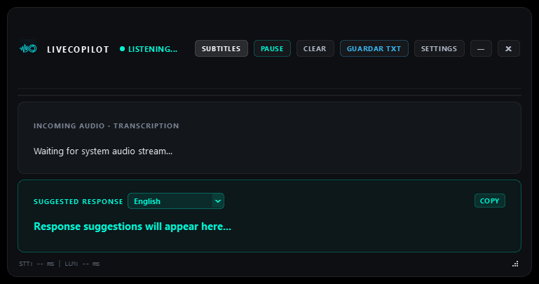
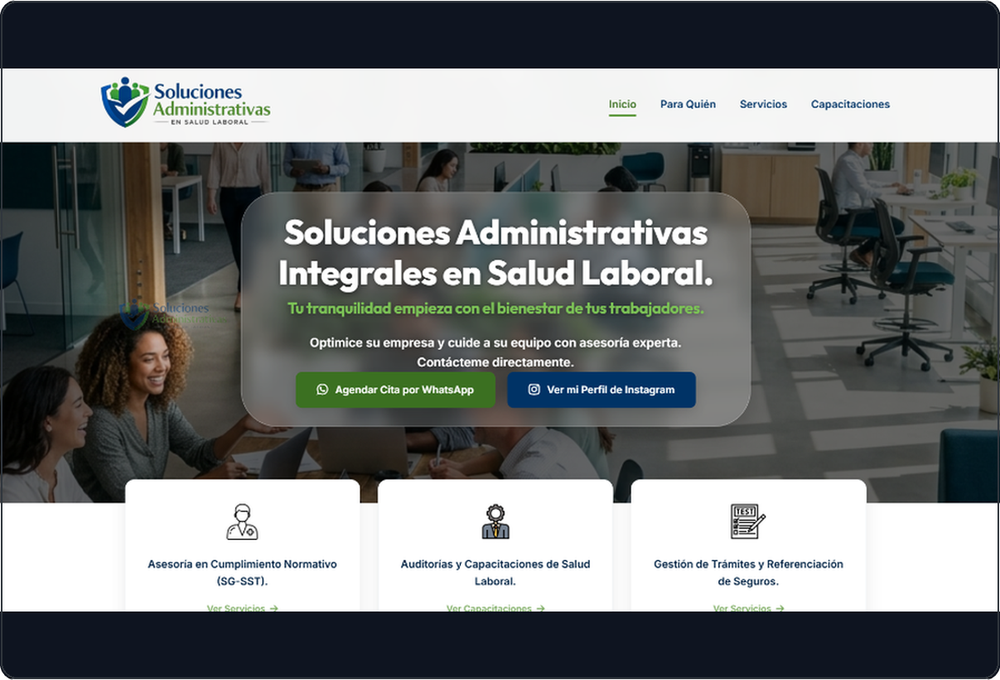

 

 

## Sobre mí

Soy **estudiante de Ingeniería de Software** y desarrollador Full Stack enfocado en la construcción de productos digitales escalables y de alto impacto. Mi enfoque combina una sólida formación académica con metodologías ágiles y **vibe coding**, aprovechando herramientas modernas para iterar rápido con código limpio, modular y bien documentado.

- **Frontend:** Desarrollo de interfaces limpias, intuitivas y responsivas con TypeScript, React, Next.js y Tailwind CSS.
- **Backend:** Diseño de APIs RESTful, servicios robustos con Java (Spring Boot), Node.js y Python, y modelado de datos.
- **Filosofía:** Tipado estricto, buenas prácticas de desarrollo, aprendizaje continuo y enfoque práctico en resolver problemas.

 

## Stack Tecnológico

  
   
  
   
  

| Área | Tecnologías |
|---|---|
| **Frontend** | React · Next.js · TypeScript · JavaScript · Tailwind CSS · HTML5 · CSS3 |
| **Backend** | Java · Spring Boot · Python · FastAPI · Node.js · Express · APIs REST |
| **Bases de Datos** | PostgreSQL · MongoDB · Modelado relacional y documental |
| **Herramientas & DevOps** | Git · GitHub Actions · Docker · VS Code · Postman |
| **Metodología** | Arquitectura Full Stack · Vibe Coding · Código Limpio |

 

## Proyectos Destacados

<table>
<tr>
<td width="50%" valign="top">

<h3>LiveCopilot</h3>

Copiloto de escritorio con captura de audio (WASAPI), transcripción en tiempo real y sugerencias conversacionales con IA en un HUD flotante a 60 FPS.

<a href="https://github.com/Merc4x/LiveCopilot" target="_blank"><b>Código en GitHub &rarr;</b></a>
</td>
<td width="50%" valign="top">

<h3>Salud Laboral</h3>

Plataforma web integral para la difusión, gestión y asesoría en Seguridad y Salud en el Trabajo (SG-SST), auditorías y capacitaciones empresariales.

<a href="https://tutranquilidadlaboral.onrender.com/" target="_blank"><b>Demo</b></a> &bull; <a href="https://github.com/Merc4x/proyecto_salud_laboral" target="_blank"><b>Código</b></a>
</td>
</tr>
</table>

  <a href="https://github.com/Merc4x?tab=repositories"><b>Ver todos los proyectos en mi portafolio &rarr;</b></a>

 

<h2>¿Hablamos?</h2>

Estoy abierto a oportunidades como desarrollador, consultoría y proyectos colaborativos. Escríbeme a <b><a href="mailto:alejo.quiroz2534@gmail.com">alejo.quiroz2534@gmail.com</a></b> o por <b><a href="https://wa.me/573116425806" target="_blank">WhatsApp</a></b>.

 

