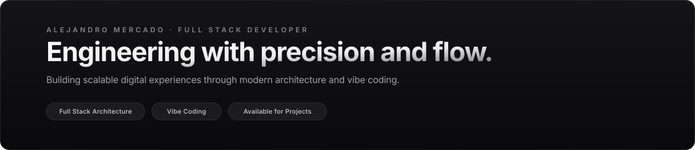

 

 

## Perfil

Desarrollador de software Full Stack centrado en la creación de aplicaciones web escalables y de alto rendimiento. Mi enfoque combina fundamentos sólidos de ingeniería con metodologías modernas de **vibe coding**, priorizando la simplicidad arquitectónica, la experiencia de usuario y la entrega continua de valor.

- **Frontend:** Construcción de interfaces limpias, intuitivas y responsivas con TypeScript, React y Next.js.
- **Backend:** Diseño e implementación de servicios modulares, APIs REST y gestión eficiente de bases de datos.
- **Filosofía:** Código mantenible, tipado riguroso y flujo de trabajo ágil potenciado por herramientas modernas.

 

## Stack Tecnológico

  

| Área | Tecnologías |
|---|---|
| **Frontend** | React, Next.js, TypeScript, JavaScript, HTML5, CSS3, Tailwind CSS |
| **Backend** | Node.js, Express, Python, FastAPI, APIs REST |
| **Bases de Datos** | PostgreSQL, MongoDB, Modelado relacional y NoSQL |
| **Herramientas & Entorno** | Git, GitHub, Docker, VS Code, Postman |
| **Enfoque** | Arquitectura Full Stack, Vibe Coding, Rendimiento y Escalabilidad |

 

## Proyectos

<table>
  <tr>
    <td width="50%" valign="top">
      <h3>LiveCopilot</h3>
      
Asistente interactivo en tiempo real enfocado en la automatización de procesos y optimización de productividad en flujos de desarrollo.

      

        <code>Python</code> &bull; <code>Full Stack</code> &bull; <code>Automation</code>
      

      <a href="https://github.com/Merc4x/LiveCopilot"><b>Ver Repositorio &rarr;</b></a>
    </td>
    <td width="50%" valign="top">
      <h3>Plataforma Web &amp; Servicios</h3>
      
Desarrollo web modular de punta a punta, con integración de autenticación segura, persistencia de datos y diseño enfocado en usabilidad.

      

        <code>React</code> &bull; <code>Node.js</code> &bull; <code>PostgreSQL</code>
      

      <a href="https://github.com/Merc4x"><b>Explorar Proyectos &rarr;</b></a>
    </td>
  </tr>
</table>

 

## Contacto

Disponible para proyectos de desarrollo, colaboraciones y nuevas oportunidades profesionales.

- **LinkedIn:** [linkedin.com/in/TU-USUARIO](https://www.linkedin.com/in/TU-USUARIO)
- **Correo:** [tu-correo@ejemplo.com](mailto:tu-correo@ejemplo.com)
- **WhatsApp:** [wa.me/TU-NUMERO](https://wa.me/TU-NUMERO)
- **GitHub:** [github.com/Merc4x](https://github.com/Merc4x)
